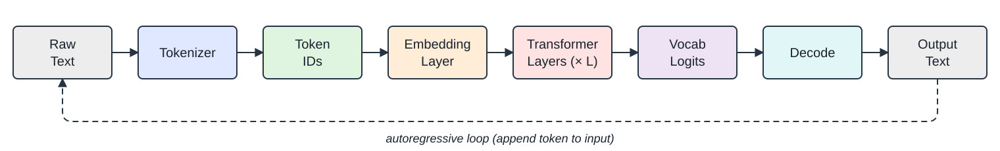

# 1.1　LLM 工作原理：直觉概览 {#how-llms-work-an-intuitive-overview}

在深入架构细节之前，让我们先建立大语言模型如何将文本转换为文本的直觉。整个过程遵循一条简单的流水线：<strong>文本 \(\to\) Token \(\to\) 表征 \(\to\) Token \(\to\) 文本</strong>。

<figure id="fig:llm-pipeline"><figcaption>图 1.1　LLM 流水线：文本被分词为子词单元，转换为整数 ID，嵌入为稠密向量，经 Transformer 层处理，投影到词表 logits，最后解码回文本。虚线回路展示自回归生成——每个输出 Token 被追加到输入中作为下一次前向传播的输入。</figcaption></figure>

四个关键阶段

<ol>
<li>
<strong>分词（Tokenization）</strong>：使用学习得到的词表将原始文本切分为子词片段（既非字符也非完整单词）。“unhappiness” 可能被切为 [“un”, “happiness”] 或 [“unhapp”, “iness”]。
</li>
<li>
<strong>嵌入（Embedding）</strong>：每个 Token ID 索引到一张学习得到的嵌入表中，产生 \(\mathbb{R}^d\)（通常 \(d = 4096\)）中的稠密向量。这些向量捕捉语义含义——相似的词获得相似的向量。
</li>
<li>
<strong>上下文处理</strong>：Transformer 栈并行处理所有嵌入，通过自注意力让每个位置“读取”所有其他位置。经过 \(L\) 层之后，每个位置的隐藏状态编码了丰富的上下文信息。
</li>
<li>
<strong>预测</strong>：最终的隐藏状态被投影为整个词表上的概率分布，由解码策略选择下一个 Token。
</li>
</ol>

