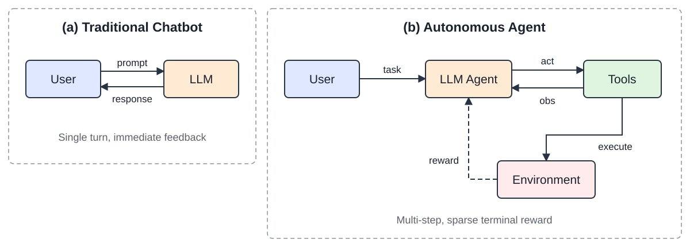

# 第 12 章 · LLM 智能体训练 {#llm-agentic-training}

<ul class="chapter-outline" aria-label="本章阅读">
<li><a href="#motivation-from-chatbots-to-autonomous-agents">12.1–12.5 · 训练基础与方法</a></li>
<li><a href="reading-02.md#use-case-agentic-rl-for-a-productivity-co-pilot">12.6–12.7 · 训练用例</a></li>
<li><a href="reading-03.md#state-of-the-art-rl-for-llm-agents">12.8–12.9 · 前沿方法与交互环境</a></li>
</ul>

## 12.1　动机：从聊天机器人到自主智能体 {#motivation-from-chatbots-to-autonomous-agents}

现代 LLM 越来越多地被部署，不仅作为对话助手，而且作为<strong>自主智能体（Autonomous Agents）</strong>，能够在多个步骤中与外部工具、API、数据库和环境进行交互。这种从单轮聊天机器人到多步智能体的转变，引入了根本性的新 RL 挑战，要求我们重新思考如何训练、评估和部署语言模型。

<figure id="figure-12-1"><figcaption>图 12.1　从聊天机器人到自主智能体：传统的 LLM 聊天机器人在带有即时人类反馈的单步对话循环中运行。自主智能体跨多个工具交互进行规划，从真实世界的执行环境中接收反馈，并针对稀疏的终端 reward（任务成功/失败）进行优化。</figcaption></figure>

要求新 RL 方法的关键差异：

<ul>
<li>
<strong>多步推理</strong>：Agent 必须跨越 10–100+ 次工具调用进行规划，而不仅仅是生成单一响应。
</li>
<li>
<strong>外部环境反馈</strong>：Reward 来自真实世界的执行（测试套件通过、网页加载、代码编译），而不仅仅是人类偏好分数。
</li>
<li>
<strong>结构化动作</strong>：动作不仅是 Token，而是结构化输出（JSON 工具调用、API 负载、代码块）。
</li>
<li>
<strong>长视野与稀疏 reward</strong>：成功/失败可能只能在多个中间步骤之后才能确定。
</li>
</ul>

为什么标准 RLHF 对 Agent 不够用

标准 RLHF（PPO/DPO）针对单轮质量进行优化：给定一个 Prompt，产生一个好的响应。但 Agent 必须：

<ul>
<li>
决定<em>何时</em>使用工具，还是进行内部推理
</li>
<li>
在轨迹中途从错误中恢复（自我纠正）
</li>
<li>
平衡探索（尝试新方法）与利用（使用已知良好模式）
</li>
<li>
处理部分可观测性（工具输出可能不完整或带噪声）
</li>
</ul>

这要求训练方法在<strong>完整轨迹</strong>上进行推理，而不是单个轮次。

## 12.2　LLM Agent 的轨迹缓冲区 {#trajectory-buffers-for-llm-agents}

在 LLM Agent 的语境下，传统的 RL 回放缓冲区经历了结构性的转变。Agent 缓冲区——通常称为<strong>轨迹缓冲区（Trajectory Buffers）</strong>、<strong>经验池（Experience Pools）</strong>或<strong>记忆库（Memory Banks）</strong>——不再存储低维数值 Tensor，而是管理复杂的文本历史、工具执行输出和显式推理步骤。

### 12.2.1　LLM Agent 缓冲区的数学结构 {#mathematical-structure-of-an-llm-agent-buffer}

在经典 RL 中，回放缓冲区存储扁平元组 \((s, a, r, s&#x27;)\)。对于 LLM Agent，这扩展为高维的 Token 化文本结构：

\[\boxed{e_t = \left( \mathcal{S}_t,\; \mathcal{A}_t,\; \mathcal{R}_t,\; \mathcal{S}_{t+1} \right)}
\tag{12.1}\]

<ul>
<li>
\(\mathcal{S}_t\)：<strong>完整上下文状态</strong>——系统 Prompt、用户目标、对话历史，以及当前环境变量（例如 HTML 源代码、目录结构、数据库 Schema）。
</li>
<li>
\(\mathcal{A}_t\)：Agent 的<strong>生成输出</strong>，通常由一段思维链（Chain-of-Thought，CoT）推理字符串紧接一个结构化工具调用组成：

\[\mathcal{A}_t = \{\text{text}_{\text{reasoning}},\; \text{json}_{\text{tool\_call}}\}
\tag{12.2}\]
</li>
<li>
\(\mathcal{R}_t\)：<strong>评估信号</strong>，来自外部执行环境（单元测试通过、编译器标志、API 响应码），或由 LLM-as-a-judge 系统验证。
</li>
<li>
\(\mathcal{S}_{t+1}\)：<strong>更新后的上下文窗口</strong>，将工具输出文本或错误日志直接附加到对话历史中。
</li>
</ul>

具体 Agent 轨迹：代码调试

<strong>步骤 1</strong>：\(\mathcal{S}_1\) = “修复 <code>utils.py</code> 中失败的测试” \(\mathcal{A}_1\) = <em>“让我先读取该文件”</em> + <code>read_file(&quot;utils.py&quot;)</code> \(\mathcal{R}_1\) = 0（中间步骤） <strong>步骤 2</strong>：\(\mathcal{S}_2\) = [先前上下文 + 文件内容] \(\mathcal{A}_2\) = <em>“Bug 在第 42 行，是一个差一错误”</em> + <code>edit_file(&quot;utils.py&quot;, ...)</code> \(\mathcal{R}_2\) = 0（中间步骤） <strong>步骤 3</strong>：\(\mathcal{S}_3\) = [先前上下文 + 编辑确认] \(\mathcal{A}_3\) = <em>“让我验证修复”</em> + <code>run_tests()</code> \(\mathcal{R}_3\) = +1.0（所有测试通过——稀疏终端 reward）

## 12.3　操作范式 {#operational-paradigms}

LLM Agent 通过三种主要的优化方法论来利用专门的轨迹缓冲区：

### 12.3.1　A. 自我纠正与思维细化 {#a.-self-correction-and-thought-refinement-star-reflexion}

此类别中的两种代表性方法是 STaR <a class="book-citation" id="cite-zelikman2022star-1" href="../../references.md#ref-zelikman2022star" aria-label="参考文献 418">[418]</a> 和 Reflexion <a class="book-citation" id="cite-shinn2023reflexion-1" href="../../references.md#ref-shinn2023reflexion" aria-label="参考文献 326">[326]</a>。当 Agent 在一次多步执行轨迹中失败时，次优序列会被保存到缓冲区。该框架随后采样此轨迹，并提示 LLM 对其过去的表现生成显式文本批评：

\[\text{Critique} \leftarrow \text{LLM}(\mathcal{S}_{\text{failed}},\; \mathcal{A}_{\text{failed}},\; \mathcal{R}_{=0})
\tag{12.3}\]

一旦修正后的轨迹获得正向 reward，它就被移至最优经验池，用于通过微调（在成功轨迹上做 SFT）或 RL（采用二元通过/失败 reward 的 GRPO <a class="book-citation" id="cite-shao2024deepseekmath-1" href="../../references.md#ref-shao2024deepseekmath" aria-label="参考文献 323">[323]</a>）来更新网络权重。

STaR：自学习推理者

<ol>
<li>
为一批问题生成推理轨迹
</li>
<li>
过滤：仅保留导致正确答案的轨迹
</li>
<li>
在成功轨迹上微调模型（SFT）
</li>
<li>
重复：改进后的模型在下一次迭代中生成更好的轨迹
</li>
</ol>

每次迭代都使用模型自身的成功输出作为训练数据，自举其推理能力。

Reflexion：语言强化学习

<ol>
<li>
Agent 尝试一项任务，失败
</li>
<li>
Agent 生成一段<strong>语言反思</strong>：“我失败是因为在调用 API 之前没有检查返回类型”
</li>
<li>
反思被存储在一个情节记忆缓冲区中
</li>
<li>
在下一次尝试中，反思作为经验教训被注入到 Prompt 中
</li>
<li>
不需要权重更新——纯粹通过自我批评进行上下文学习
</li>
</ol>

### 12.3.2　B. 离策略探索 {#b.-off-policy-exploration-react-tool-use-frameworks}

此范式以 ReAct <a class="book-citation" id="cite-yao2023react-1" href="../../references.md#ref-yao2023react" aria-label="参考文献 408">[408]</a> 及相关工具使用框架为代表，涉及广泛的自主探索。在自主探索过程中（网页导航、数据库查询、代码生成），Agent 记录数千条探索性执行路径。轨迹缓冲区充当一个过滤器：

<ul>
<li>
<strong>成功过滤</strong>：只保留达成目标的轨迹用于训练。
</li>
<li>
<strong>效率排序</strong>：在成功轨迹中，优先选择最短/最高效的工具使用路径。
</li>
<li>
<strong>多样性采样</strong>：维持多样化的解决策略集合，以防止模式坍塌。
</li>
</ul>

优化算法（通常是 GRPO <a class="book-citation" id="cite-shao2024deepseekmath-2" href="../../references.md#ref-shao2024deepseekmath" aria-label="参考文献 323">[323]</a> 或过滤后的 SFT）只在高效、成功的轨迹上计算 Loss，丢弃迂回曲折的运行。

### 12.3.3　C. 非参数化的上下文学习（基于经验的 RAG） {#c.-non-parametric-in-context-learning-rag-over-experiences}

轨迹缓冲区可以不修改神经网络权重，而是作为一个<strong>向量数据库</strong>。给定一个新的用户目标 \(\mathcal{G}_{\text{new}}\)，系统检索最相关的过往经验：

\[\boxed{\mathcal{E}_{\text{retrieved}} = \arg\max_{e \in \mathcal{B}} \text{sim}\!\left(\text{Embed}(\mathcal{G}_{\text{new}}),\; \text{Embed}(e)\right)}
\tag{12.4}\]

Top-\(k\) 个相似的成功历史运行作为 few-shot 示例直接注入到 Prompt 上下文中。这种方法：

<ul>
<li>
需要<strong>零训练</strong>——纯粹的检索增强生成（Retrieval-Augmented Generation, RAG）
</li>
<li>
如果缓冲区中存在相似经验，可即时适应新任务
</li>
<li>
随缓冲区规模扩展（更多经验 = 更好的覆盖率）
</li>
<li>
与参数化学习互补（罕见情况使用检索，常见模式使用权重）
</li>
</ul>

## 12.4　范式对比 {#paradigm-comparison}

表 12.1　传统 RL 缓冲区与 LLM Agent 缓冲区对比

<table>
<thead><tr><th scope="col"><strong>特性</strong></th><th scope="col"><strong>传统 RL 缓冲区</strong></th><th scope="col"><strong>LLM Agent 缓冲区</strong></th></tr></thead>
<tbody><tr><td><strong>数据格式</strong></td><td>连续向量 / Tensor</td><td>Token 化文本、JSON、代码块、工具输出</td></tr>
<tr><td><strong>数据量</strong></td><td>海量（\(10^5\)–\(10^7\) 条）</td><td>中小规模（\(10^3\)–\(10^5\) 条轨迹）</td></tr>
<tr><td><strong>主要目标</strong></td><td>打破数据相关性</td><td>提供推理示范</td></tr>
<tr><td><strong>采样</strong></td><td>随机均匀 / PER</td><td>语义检索 / 成功优先 / 多样性</td></tr>
<tr><td><strong>状态大小</strong></td><td>固定（如 84\(\times\)84 像素）</td><td>可变（每个状态 1K–128K Token）</td></tr>
<tr><td><strong>动作空间</strong></td><td>离散/连续向量</td><td>结构化文本（推理 + 工具调用）</td></tr>
<tr><td><strong>Reward 来源</strong></td><td>环境模拟器</td><td>外部执行 / LLM judge / 单元测试</td></tr></tbody>
</table>

## 12.5　Agent RL 的主要技术 {#major-techniques-in-agentic-rl}

表 12.2　用 RL 训练 LLM Agent 的关键方法。

<table>
<thead><tr><th scope="col"><strong>方法</strong></th><th scope="col"><strong>类型</strong></th><th scope="col"><strong>核心思想</strong></th></tr></thead>
<tbody><tr><td><strong>STaR</strong> <a class="book-citation" id="cite-zelikman2022star-1--section-05" href="../../references.md#ref-zelikman2022star" aria-label="参考文献 418">[418]</a></td><td>迭代 SFT</td><td>通过在自身成功轨迹上微调来自举推理能力</td></tr>
<tr><td><strong>Reflexion</strong> <a class="book-citation" id="cite-shinn2023reflexion-1--section-05" href="../../references.md#ref-shinn2023reflexion" aria-label="参考文献 326">[326]</a></td><td>上下文 RL</td><td>语言式自我批评作为情节记忆存储；无权重更新</td></tr>
<tr><td><strong>ReAct</strong> <a class="book-citation" id="cite-yao2023react-1--section-05" href="../../references.md#ref-yao2023react" aria-label="参考文献 408">[408]</a></td><td>Prompt 方法</td><td>在单次生成中交错推理（“思考”）与行动（“工具调用”）</td></tr>
<tr><td><strong>LATS</strong> <a class="book-citation" id="cite-zhou2024lats-1" href="../../references.md#ref-zhou2024lats" aria-label="参考文献 438">[438]</a></td><td>树搜索</td><td>在动作序列上做蒙特卡洛树搜索；反向传播 reward</td></tr>
<tr><td><strong>AgentQ</strong> <a class="book-citation" id="cite-putta2024agentq-1" href="../../references.md#ref-putta2024agentq" aria-label="参考文献 294">[294]</a></td><td>离策略 RL</td><td>在 Agent 轨迹上用 AI 生成的偏好对做 DPO</td></tr>
<tr><td><strong>OpenHands</strong> <a class="book-citation" id="cite-wang2024openhands-1" href="../../references.md#ref-wang2024openhands" aria-label="参考文献 366">[366]</a></td><td>GRPO</td><td>基于执行的 reward（测试通过/失败）做组相对优化</td></tr>
<tr><td><strong>Voyager</strong> <a class="book-citation" id="cite-wang2023voyager-1" href="../../references.md#ref-wang2023voyager" aria-label="参考文献 362">[362]</a></td><td>技能库</td><td>存储并检索成功代码片段以组合复用</td></tr>
<tr><td><strong>RLEF</strong> <a class="book-citation" id="cite-le2024rlef-1" href="../../references.md#ref-le2024rlef" aria-label="参考文献 200">[200]</a></td><td>在线 RL</td><td>从执行反馈中做 RL——来自代码/测试执行的二元 reward</td></tr></tbody>
</table>

### 12.5.1　STaR：自学习推理者（详解） {#star-self-taught-reasoner-detailed}

STaR <a class="book-citation" id="cite-zelikman2022star-2" href="../../references.md#ref-zelikman2022star" aria-label="参考文献 418">[418]</a> 是一种<strong>迭代式自我改进</strong>方法，无需外部 Reward Model 即可自举推理能力。核心洞见：如果模型偶尔能正确解决一个问题，它就可以从自身的成功中学习。

<strong>算法</strong>：

<ol>
<li>
<strong>生成</strong>：对数据集 \(\mathcal{D}\) 中的每个问题 \(x_i\)，采样一条推理轨迹 \(z_i \sim \pi_\theta(\cdot | x_i)\)，后跟一个答案 \(\hat{y}_i\)。
</li>
<li>
<strong>过滤</strong>：仅保留满足 \(\hat{y}_i = y_i^*\)（正确答案）的轨迹。定义成功集 \(\mathcal{D}_{\text{pass}} = \{(x_i, z_i, y_i^*) : \hat{y}_i = y_i^*\}\)。
</li>
<li>
<strong>合理化（Rationalization）</strong>（关键创新）：对模型失败的问题，生成一条以正确答案为条件的“合理化”轨迹：\(z_i^{\text{rat}} \sim \pi_\theta(\cdot | x_i, y_i^*)\)。这教导模型从解<em>反向</em>推理。
</li>
<li>
<strong>微调</strong>：在 \(\mathcal{D}_{\text{pass}} \cup \mathcal{D}_{\text{rationalized}}\) 上通过 SFT 更新 \(\theta\)。
</li>
<li>
<strong>迭代</strong>：用改进后的模型从步骤 1 重复。
</li>
</ol>

\[\boxed{\theta_{k+1} = \arg\min_\theta -\sum_{(x,z,y) \in \mathcal{D}_k^+} \log \pi_\theta(z, y | x)}
\tag{12.5}\]

<strong>收敛动力学</strong>：每次迭代 \(k\) 都会提升模型的解题率 \(p_k\)。若 \(p_0 = 0.3\)（解出 30% 的问题），经过合理化 + SFT 后 \(p_1 \approx 0.5\)。通常 3–5 次迭代后收敛至 \(p \approx 0.7\)–\(0.9\)。

STaR 合理化 Prompt

<pre><code># 标准生成（步骤 1）：
PROMPT = """Solve the following problem step by step.
Problem: A store has 45 apples. It sells 3/5 of them. How many remain?
Let's think step by step:"""

# 合理化 Prompt（步骤 3——以正确答案为条件）：
PROMPT_RATIONALIZE = """Solve the following problem step by step.
The correct answer is 18.
Problem: A store has 45 apples. It sells 3/5 of them. How many remain?
Let's think step by step to arrive at 18:"""

# Agent 变体（带错误条件的代码任务）：
PROMPT_AGENT_RATIONALIZE = """The following code task failed with the error below.
Generate a correct solution step by step.

Task: Implement binary search that handles duplicates.
Previous error: IndexError: list index out of range (line 12)
Correct behavior: Return leftmost index of target.

Let me fix this by reasoning about the boundary conditions:"""
</code></pre>

面向 Agent 的 STaR 变体

<ul>
<li>
<strong>Quiet-STaR</strong> <a class="book-citation" id="cite-zelikman2024quietstar-1" href="../../references.md#ref-zelikman2024quietstar" aria-label="参考文献 419">[419]</a>：在每个生成 Token 之间插入“思考 Token”。模型学会在没有显式 CoT 提示的情况下<em>隐式</em>推理。训练目标：在包含思考 Token 时更好地预测下一个 Token。
</li>
<li>
<strong>代码 Agent 的 STaR</strong>：用测试执行替代答案验证。“正确” = 所有测试通过。合理化 = 以错误消息为条件生成新方法。
</li>
<li>
<strong>V-STaR</strong> <a class="book-citation" id="cite-hosseini2024vstar-1" href="../../references.md#ref-hosseini2024vstar" aria-label="参考文献 143">[143]</a>：增加一个在 \((z, y, \text{correct/incorrect})\) 三元组上训练的验证器模型。该验证器提供过程级监督，过滤那些偶然到达正确答案的糟糕推理轨迹。
</li>
</ul>

### 12.5.2　Reflexion：语言强化学习（详解） {#reflexion-verbal-reinforcement-learning-detailed}

Reflexion <a class="book-citation" id="cite-shinn2023reflexion-2" href="../../references.md#ref-shinn2023reflexion" aria-label="参考文献 326">[326]</a> 引入了一种激进的范式：<strong>无权重更新的 RL</strong>。Agent 不通过基于梯度的学习，而是通过存储在情节记忆中的自然语言自我批评来改进。

<strong>完整架构</strong>：

<ol>
<li>
<strong>Actor</strong>：在环境中执行动作的 LLM Agent \(\pi\)。
</li>
<li>
<strong>评估器</strong>：二元信号（任务成功/失败）或标量启发式（如通过的测试用例数）。
</li>
<li>
<strong>自我反思生成器</strong>：给定失败轨迹 \(\tau_{\text{fail}}\) 和环境反馈，生成自然语言反思 \(r_{\text{text}}\)：

\[r_{\text{text}} = \text{LLM}_{\text{reflect}}\!\left(\tau_{\text{fail}}, \text{feedback}, \text{task}\right)
\tag{12.6}\]
</li>
<li>
<strong>情节记忆</strong>：过往反思的滑动窗口缓冲区 \(\mathcal{M} = [r_1, r_2, \ldots, r_m]\)（通常 \(m \leq 3\) 以适应上下文）。
</li>
<li>
<strong>重试循环</strong>：下一次尝试时，反思被注入到 Prompt 中：

\[a_{t+1} \sim \pi\!\left(\cdot\; |\; \text{task},\; \mathcal{M},\; \text{current\_state}\right)
\tag{12.7}\]
</li>
</ol>

<strong>反思示例</strong>：<em>“在我上一次尝试中，我在验证输入格式之前就调用了搜索 API，导致了 400 错误。下次我应该先验证 JSON Schema，然后再发起 API 调用。”</em>

Reflexion：带记忆注入的 Agent Prompt

<pre><code># === 第 2 次尝试的 PROMPT（首次失败后）===

SYSTEM = """You are a coding agent. You can run bash commands and edit files.
Complete the task below. Learn from your previous reflections."""

USER = """Task: Fix the failing test in auth_service.py

=== REFLECTIONS FROM PREVIOUS ATTEMPTS ===
[Attempt 1 reflection]: I tried to modify the authenticate() function
directly but forgot that it depends on token_validator(). The test
failed because token_validator() was still returning the old format.
I should trace the dependency chain FIRST: check what authenticate()
calls, then fix the root cause (token_validator), not the symptom.
=== END REFLECTIONS ===

The repository is in /workspace/. The failing test is:
  test_auth.py::test_expired_token_returns_401

Begin by reading the relevant files, then fix the issue."""
</code></pre>

<strong>优势与局限</strong>：

<table>
<thead><tr><th scope="col"><strong>优势</strong></th><th scope="col"><strong>局限</strong></th></tr></thead>
<tbody><tr><td>零梯度计算；可与冻结的 API 模型（GPT-4）一起工作</td><td>受限于上下文窗口；无法积累无限知识</td></tr>
<tr><td>快速迭代（每次重试只需几秒，而 RL 训练需数小时）</td><td>无法泛化到未见任务（记忆是任务特定的）</td></tr>
<tr><td>可解释：人类可读的自我纠正</td><td>依赖模型已有的识别错误的能力</td></tr>
<tr><td>可与任意基础 Agent 架构组合</td><td>当基础模型太弱、无法生成有用批评时，效果下降</td></tr></tbody>
</table>

### 12.5.3　ReAct：推理 + 行动（详解） {#react-reasoning-acting-detailed}

ReAct <a class="book-citation" id="cite-yao2023react-2" href="../../references.md#ref-yao2023react" aria-label="参考文献 408">[408]</a> 通过在单个生成流中<strong>交错显式推理步骤与环境动作</strong>，确立了工具使用 Agent 的主导 Prompt 范式。

ReAct 系统 Prompt（典型）

<pre><code>SYSTEM = """You are a research assistant with access to the following tools:
- search(query): Search the web for information
- lookup(term): Look up a term on the current Wikipedia page
- finish(answer): Submit your final answer

Solve the user's question by interleaving Thought and Action steps.
Format:
  Thought: &lt;your reasoning about what to do next&gt;
  Action: &lt;tool_name&gt;(arguments)

You will receive an Observation after each Action. Use it to plan
your next step. Continue until you can provide a final answer.

Rules:
- Always think before acting
- Never guess - verify with tools
- Use finish() only when you are confident in your answer"""

USER = "Who was the president of the US when the iPhone was released?"
</code></pre>

<strong>生成格式</strong>：

ReAct 轨迹格式

<pre><code>Thought: I need to find when the iPhone was released, then determine
who was president at that time. Let me search for the release date.
Action: search("iPhone original release date")
Observation: The original iPhone was released on June 29, 2007.
Thought: The iPhone came out June 2007. Now I need to find who was
the US president in June 2007.
Action: lookup("President of the United States in 2007")
Observation: George W. Bush served as the 43rd president from
January 20, 2001 to January 20, 2009.
Thought: George W. Bush was president from 2001-2009, which covers
June 2007 when the iPhone was released. I have my answer.
Action: finish("George W. Bush was the US president when the iPhone
was released on June 29, 2007.")
</code></pre>

<strong>形式化定义</strong>：一条 ReAct 轨迹是 \(\tau = (t_1, a_1, o_1, t_2, a_2, o_2, \ldots)\)，其中：

<ul>
<li>
\(t_i\)：思考（内部推理，不被执行）
</li>
<li>
\(a_i\)：动作（工具调用，在环境中执行）
</li>
<li>
\(o_i\)：观测（环境响应，附加到上下文）
</li>
</ul>

<strong>为什么有效</strong>：思考创造了一种“内心独白”，帮助模型在行动前规划，减少冲动性工具调用。显式推理轨迹也让 Agent 的决策过程<strong>可审计</strong>且<strong>可调试</strong>。

<strong>用 RL 训练 ReAct Agent</strong>：

<ul>
<li>
<strong>动作级 reward</strong>：只有动作接收 reward 信号（思考是辅助的）。
</li>
<li>
<strong>思考质量</strong>：隐式优化——更好的思考 \(\rightarrow\) 更好的动作 \(\rightarrow\) 更高的 reward。
</li>
<li>
<strong>格式强制</strong>：在 reward 中加入对格式错误动作（缺失 JSON、幻觉工具）的格式惩罚。
</li>
<li>
<strong>RL 目标</strong>：\(r(\tau) = r_{\text{task}} - \lambda_{\text{format}} \cdot \text{format\_violations} - \lambda_{\text{length}} \cdot \text{num\_steps}\)
</li>
</ul>

### 12.5.4　LATS：语言 Agent 树搜索（详解） {#lats-language-agent-tree-search-detailed}

LATS <a class="book-citation" id="cite-zhou2024lats-2" href="../../references.md#ref-zhou2024lats" aria-label="参考文献 438">[438]</a> 将<strong>蒙特卡洛树搜索（Monte Carlo Tree Search, MCTS）</strong>应用于 LLM Agent 的动作选择，以推理算力换取显著更好的轨迹。

<strong>算法（针对 LLM Agent 改造）</strong>：

<ol>
<li>
<strong>选择</strong>：从根节点（初始状态）开始，使用 UCB1 遍历树：

\[\text{UCB}(s, a) = \bar{Q}(s, a) + c \sqrt{\frac{\ln N(s)}{N(s, a)}}
\tag{12.8}\]

其中 \(\bar{Q}\) = 子树平均 reward，\(N\) = 访问计数，\(c\) = 探索常数。
</li>
<li>
<strong>扩展</strong>：在叶节点，通过 LLM 采样（温度 \(&gt; 0\)）生成 \(k\) 个候选动作：\(\{a_1, \ldots, a_k\} \sim \pi_\theta(\cdot | s_{\text{leaf}})\)
</li>
<li>
<strong>模拟</strong>：对每个候选，在环境中执行该动作，然后用快速 rollout 策略（贪心解码）继续，直到终止状态或深度限制。
</li>
<li>
<strong>反向传播</strong>：将终端 reward 沿所有祖先节点向上传播，更新 \(\bar{Q}\) 和 \(N\) 计数。
</li>
<li>
<strong>重复</strong>：在固定计算预算（如 50–200 次迭代）下运行步骤 1–4。
</li>
<li>
<strong>动作选择</strong>：选择根节点访问次数最多的子节点。
</li>
</ol>

<strong>LLM 特定的改造</strong>：

<ul>
<li>
<strong>Value 函数</strong>：使用独立的 LLM 调用来估计状态价值：“在 0–1 范围内，这个状态导致任务成功的可能性有多大？”
</li>
<li>
<strong>基于反思的剪枝</strong>：当某个分支失败时，生成反思并剪枝相似分支。
</li>
<li>
<strong>缓存</strong>：在每个节点存储 LLM 输出，避免回溯时重复生成。
</li>
<li>
<strong>深度预算</strong>：将树深度限制在 10–20 步（Agent 很少需要更多）。
</li>
</ul>

<strong>性能</strong>：在 WebShop（网页导航）上，LATS 达到 75% 成功率，而 ReAct 仅为 40%。在 HumanEval（代码）上，借助树搜索 pass@1 从 68% 提升至 94%。代价：每个任务的推理 FLOPs 增加 10–50\(\times\)。

LATS Prompt：价值估计与节点扩展

<pre><code># === 价值估计 PROMPT（用于模拟阶段）===
VALUE_PROMPT = """You are evaluating an agent's progress on a task.

Task: Book a flight from NYC to London for under \$500, departing Dec 15.

Current state (after 3 actions):
- Searched flights on Kayak: found 12 results
- Filtered by price &lt; \$500: 4 options remain
- Clicked on British Airways \$489 option: viewing details page

On a scale of 0.0 to 1.0, how likely is the agent to successfully
complete the task from this state? Consider:
- How close is the agent to the goal?
- Are there remaining obstacles (payment, seat selection)?
- Has the agent made any errors that need correction?

Score: """  # 模型输出，例如 "0.75"

# === 节点扩展 PROMPT（生成候选动作）===
EXPAND_PROMPT = """You are a web navigation agent. Given the current
page state, propose 3 DIFFERENT next actions to try.

Current page: British Airways booking - flight details
  Price: \$489 | Departure: Dec 15 8:30am | Arrival: Dec 15 8:45pm
  [Button: Select] [Button: Back to results] [Link: Fare rules]

Generate 3 diverse candidate actions (explore different strategies):
Action 1:"""  # 模型生成 3 个选项用于树扩展
</code></pre>

### 12.5.5　AgentQ：在 Agent 轨迹上做 DPO（详解） {#agentq-dpo-on-agent-trajectories-detailed}

AgentQ <a class="book-citation" id="cite-putta2024agentq-2" href="../../references.md#ref-putta2024agentq" aria-label="参考文献 294">[294]</a> 通过从轨迹结果自动生成偏好对，桥接了<strong>离线偏好学习（DPO）</strong>与<strong>在线 Agent 执行</strong>。

<strong>流水线</strong>：

<ol>
<li>
<strong>Rollout</strong>：使用当前 Policy \(\pi_\theta\) 为每个任务执行 \(N\) 条轨迹。
</li>
<li>
<strong>评估</strong>：用基于执行的 reward（二元通过/失败或标量指标）为每条轨迹打分。
</li>
<li>
<strong>偏好对构造</strong>：对每个任务，构造偏好对：

\[(\tau_w, \tau_l) \text{ where } r(\tau_w) &gt; r(\tau_l)
\tag{12.9}\]

在同一任务的轨迹中，reward 最高者 = 被选（chosen），最低者 = 被拒（rejected）。
</li>
<li>
<strong>DPO 更新</strong>：在轨迹级对数概率上应用标准 DPO Loss：

\[\mathcal{L}_{\text{AgentQ}} = -\log \sigma\!\left(\beta \left[\log\frac{\pi_\theta(\tau_w)}{\pi_{\text{ref}}(\tau_w)} - \log\frac{\pi_\theta(\tau_l)}{\pi_{\text{ref}}(\tau_l)}\right]\right)
\tag{12.10}\]
</li>
<li>
<strong>迭代</strong>：更新后的 \(\pi_\theta\) 在下一轮生成更好的轨迹。
</li>
</ol>

<strong>关键设计选择</strong>：

<ul>
<li>
<strong>MCTS 引导的探索</strong>：在 rollout 阶段使用 LATS 生成多样、高质量的轨迹（更好的训练数据）。
</li>
<li>
<strong>步骤级 DPO</strong>：不比较完整轨迹，而是在<em>动作级别</em>比较——给定相同前缀，哪个下一动作导向成功？
</li>
<li>
<strong>自对弈改进</strong>：每次 DPO 迭代都产生更好的 Policy，生成更好的轨迹，从而产生更好的训练对——一个良性循环。
</li>
</ul>

<strong>结果</strong>：在 WebShop 上，AgentQ 在 3 次 DPO 迭代后将成功率从 50% 绝对提升至 82%。

### 12.5.6　Voyager：通过技能库实现终身学习（详解） {#voyager-lifelong-learning-via-skill-libraries-detailed}

Voyager <a class="book-citation" id="cite-wang2023voyager-2" href="../../references.md#ref-wang2023voyager" aria-label="参考文献 362">[362]</a> 引入了<strong>组合式技能积累</strong>——Agent 构建一个不断增长的可复用代码函数库，作为高层动作。

<strong>架构</strong>：

<ol>
<li>
<strong>自动课程</strong>：一个 LLM 根据 Agent 当前的技能清单提议逐渐更难的任务：“你现在能挖木头并合成木板。下一个挑战：建造一个工作台。”
</li>
<li>
<strong>技能生成</strong>：对每个任务，Agent 编写一个 JavaScript 函数（可执行代码）来解决它：

\[\text{skill}_i = \text{LLM}(\text{task}_i, \text{environment\_docs}, \text{error\_feedback})
\tag{12.11}\]
</li>
<li>
<strong>验证</strong>：在环境中执行代码。如果成功，加入技能库。若失败，借助错误反馈迭代（最多 5 次重试）。
</li>
<li>
<strong>技能库</strong>（向量数据库）：每个已验证技能存储：

<ul>
<li>
函数签名 + Docstring（用于检索）
</li>
<li>
任务描述的 Embedding（用于语义搜索）
</li>
<li>
依赖（它调用了哪些其他技能）
</li>
</ul></li>
<li>
<strong>检索 + 组合</strong>：对新任务，检索 top-\(k\) 最相关技能并加以组合：

\[\text{solution} = \text{LLM}(\text{new\_task}, \text{retrieve}(\text{skill\_library}, k{=}5))
\tag{12.12}\]
</li>
</ol>

<strong>关键洞见</strong>：技能是<strong>可组合的</strong>——复杂行为从组合简单的、已验证的函数中涌现。Agent 永不遗忘（库是持久的）并单调改进（只加入已验证的技能）。

Voyager：课程与技能生成 Prompt

<pre><code># === 自动课程 PROMPT ===
CURRICULUM_PROMPT = """You are a curriculum designer for an AI agent.

Agent's current skill inventory:
- mine_wood(): Mines nearby oak/birch trees
- craft_planks(): Converts logs to planks
- craft_sticks(): Converts planks to sticks
- mine_stone(): Mines stone with wooden pickaxe

Propose the next task that:
1. Builds on existing skills (reachable from current abilities)
2. Introduces exactly ONE new concept or challenge
3. Is concrete and verifiable (clear success condition)

Next task proposal:"""
# 输出："Craft a furnace (requires 8 cobblestone blocks arranged
#       in a square). You already know mine_stone()."

# === 技能生成 PROMPT ===
SKILL_GEN_PROMPT = """Write a JavaScript function to accomplish this task
in Minecraft. Use the bot API (bot.dig, bot.craft, bot.equip, etc.)

Task: Smelt 5 iron ingots using a furnace.
Prerequisites available: mine_stone(), craft_furnace(), mine_iron_ore()

Error from previous attempt: "Cannot smelt without fuel in furnace"

Write the corrected function:
async function smeltIronIngots(bot, count=5) {"""
</code></pre>

### 12.5.7　RLEF：从执行反馈中做 RL（详解） {#rlef-rl-from-execution-feedback-detailed}

RLEF <a class="book-citation" id="cite-le2024rlef-2" href="../../references.md#ref-le2024rlef" aria-label="参考文献 200">[200]</a> 将<strong>带确定性执行 reward 的在线 RL</strong>应用于代码生成 Agent，确立了 Agent 训练最简单的有效范式。

<strong>训练循环</strong>：

<ol>
<li>
<strong>采样任务</strong>：从训练集中抽取一个带测试用例的编程问题 \((x, \text{tests})\)。
</li>
<li>
<strong>生成</strong>：Agent 使用当前 Policy \(\pi_\theta\) 产生一条解决轨迹（读文件、写代码、运行测试）。
</li>
<li>
<strong>执行</strong>：在沙盒环境中运行测试套件。Reward：

\[r = \frac{\text{\# tests passed}}{\text{\# total tests}} \in [0, 1]
\tag{12.13}\]
</li>
<li>
<strong>更新</strong>：使用 \(r\) 作为 reward 信号应用 GRPO/PPO。
</li>
<li>
<strong>重复</strong>：用新鲜任务进行数千次迭代。
</li>
</ol>

<strong>为什么执行反馈对 RL 是理想的</strong>：

<ul>
<li>
<strong>零噪声</strong>：与人类偏好不同，测试结果是确定的。相同代码 \(\rightarrow\) 每次相同 reward。这消除了破坏 RL 训练稳定性的 reward 噪声。
</li>
<li>
<strong>无限规模</strong>：可以编程式地生成无限任务（随机算法、API 集成测试、数据变换）。
</li>
<li>
<strong>无 reward hacking</strong>：与学习得到的 Reward Model 不同，测试套件无法被“愚弄”（前提是测试写得好）。Agent 必须真正解决问题。
</li>
<li>
<strong>密集信号</strong>：部分测试通过（\(r = 0.6\)）提供比二元通过/失败更丰富的梯度。
</li>
</ul>

### 12.5.8　OpenHands / SWE-Agent：用于软件工程的 GRPO {#openhands-swe-agent-grpo-for-software-engineering}

OpenHands <a class="book-citation" id="cite-wang2024openhands-2" href="../../references.md#ref-wang2024openhands" aria-label="参考文献 366">[366]</a> 和 SWE-Agent <a class="book-citation" id="cite-yang2024sweagent-1" href="../../references.md#ref-yang2024sweagent" aria-label="参考文献 404">[404]</a> 应用 GRPO 训练自主解决 GitHub Issue 的 Agent——读取代码、编写补丁、运行测试套件。

<strong>训练细节</strong>：

<ul>
<li>
<strong>环境</strong>：包含完整仓库、测试套件和开发者工具（git、grep、lint）的 Docker 容器。
</li>
<li>
<strong>动作空间</strong>：Bash 命令、文件编辑、git 操作、测试执行。
</li>
<li>
<strong>轨迹长度</strong>：解决一个 GitHub Issue 通常需要 15–50 个动作。
</li>
<li>
<strong>Reward</strong>：二元——生成的补丁是否通过该 Issue 的回归测试？
</li>
<li>
<strong>组大小</strong>：每个 Issue \(N = 8\)–\(16\) 条轨迹用于 GRPO 归一化。
</li>
<li>
<strong>课程</strong>：从标记为“good first issue”的开始，逐步过渡到复杂的多文件重构。
</li>
</ul>

<strong>SOTA 结果</strong>：SWE-bench Verified：RL 训练后解决率从 30% 提升至 55%（对比仅 SFT 基线）。

OpenHands / SWE-Agent：系统 Prompt

<pre><code>SYSTEM = """You are an autonomous software engineer. You are given a
GitHub issue to resolve. You have access to the full repository in
/workspace/ and can execute any bash command.

AVAILABLE COMMANDS:
- bash(command): Execute a shell command
- edit(file, start_line, end_line, new_content): Edit a file
- search(pattern, path): Search for text in files
- submit(): Submit your patch when done

WORKFLOW:
1. Read the issue carefully and understand the expected behavior
2. Explore the codebase to find relevant files
3. Reproduce the bug (write/run a test that fails)
4. Implement the fix
5. Verify the fix (run the test again - must pass)
6. Run the full test suite to check for regressions
7. Submit when all tests pass

RULES:
- Do NOT modify test files unless the issue explicitly asks for it
- Prefer minimal, targeted changes over large refactors
- Always verify your fix before submitting"""

USER = """GitHub Issue #4521: `DataFrame.merge()` silently drops
rows when `on` column contains NaN values.

Expected: NaN keys should be preserved (matched with other NaN rows)
Actual: Rows with NaN keys are dropped entirely

Repository: /workspace/pandas-dev/pandas/"""
</code></pre>

未来：RL + Agent

该领域正在汇聚于一种模式：将<strong>带基于执行 reward 的在线 RL</strong>应用于多步 Agent 轨迹。关键趋势：

<ul>
<li>
GRPO/PPO 配合来自代码执行或工具成功的二元通过/失败 reward
</li>
<li>
课程学习：从简单任务开始，逐步增加难度
</li>
<li>
轨迹级优化（而非 Token 级）——仅在多步序列末尾给出 reward
</li>
<li>
混合方法：对罕见任务使用检索（非参数化）+ 对常见任务使用 RL（参数化）
</li>
<li>
Scaling Law：推理时投入更多算力（搜索/重试）通常胜过投入更多训练算力
</li>
</ul>

