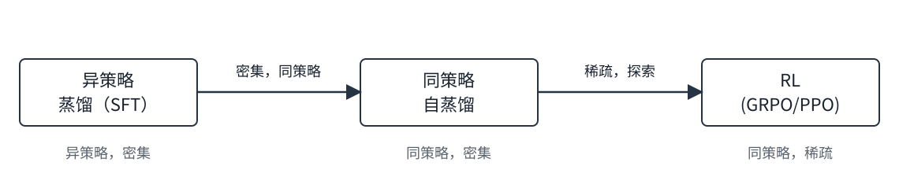

# 13.10　面向推理的同策略自蒸馏 {#sec:on-policy-self-distillation}

本章的方法——GRPO、过程奖励、MCTS——共享一个根本局限：<strong>稀疏反馈</strong>。无论序列多长，强化学习每回合只提供固定比特数的信息。一条 2000 token、最终得出错误答案的思维链只收到一个标量惩罚；模型学不到<em>哪些 token</em> 导致了失败。同策略自蒸馏（On-Policy Self-Distillation, OPSD） <a class="book-citation" id="cite-zhao2026opsd-1" href="../../references.md#ref-zhao2026opsd" aria-label="参考文献 430">[430]</a> 通过提供<strong>密集的 token 级监督</strong>、同时保留让 RL 有效的 on-policy 性质来解决这一问题。

同策略自蒸馏：核心思想

同一个 LLM 同时扮演两个角色：

<ul>
<li>
<strong>教师（Teacher）</strong>：同一个模型，但以<em>特权信息</em>为条件（例如把已验证的解答或推理轨迹附加到提示中）。
</li>
<li>
<strong>学生（Student）</strong>：模型只以原始问题为输入，生成自己的 rollout。
</li>
</ul>

训练最小化教师与学生分布之间的逐 token 散度，并在<em>学生自己的轨迹</em>上评估。不需要额外、更大的教师模型。

## 13.10.1　训练目标 {#subsec:opsd-objective}

令 \(\pi_\theta\) 表示学生策略（只给定问题的模型），\(\pi_\theta^+\) 表示教师策略（以特权上下文如已验证答案为条件的同一个模型）。对于从学生中采样的轨迹 \(x = (x_1, \ldots, x_T)\)，OPSD 损失最小化逐 token 的反向 KL 散度：

\[\mathcal{L}_{\text{OPSD}}(\theta) = \mathbb{E}_{x \sim \pi_\theta}\left[\sum_{t=1}^{T} \text{KL}\!\left(\pi_\theta(\cdot \mid x_{&lt;t}) \;\|\; \pi_\theta^+(\cdot \mid x_{&lt;t})\right)\right]\]

在实践中，这简化为在采样 token 上评估的对数概率之差：

\[\mathcal{L}_{\text{OPSD}}(\theta) \approx \mathbb{E}_{x \sim \pi_\theta}\left[\sum_{t=1}^{T} \log \pi_\theta(x_t \mid x_{&lt;t}) - \log \pi_\theta^+(x_t \mid x_{&lt;t})\right]\]

教师的对数概率只需一次前向传播（无梯度计算），使得该方法比运行独立的奖励模型或执行带延迟奖励的完整 RL rollout 便宜得多。

## 13.10.2　为什么密集监督很重要 {#subsec:opsd-dense}

信息论上的论证很有说服力：RL 每回合只教 \(O(1)\) 比特（标量奖励），而 token 级蒸馏每回合教 \(O(T)\) 比特。这直接转化为训练效率：

<ul>
<li>
<strong>Qwen3 结果</strong>：Qwen3 技术报告称，同策略蒸馏以 RL 流水线<strong>十分之一的 GPU 时长</strong>（1,800 vs. 17,920 GPU 小时）在 AIME’24 上达到 74.4%，同时超过了 RL 的 67.6%。
</li>
<li>
<strong>步数效率</strong>：实证对比显示，OPSD 用比 GRPO 少 7–10\(\times\) 的梯度步数就能达到同等的推理性能；考虑到所需上下文长度更短、批大小更小，对应 50–100\(\times\) 的算力节省。
</li>
<li>
<strong>数据复用</strong>：与在重复提示上训练时会记住最终答案的 RL 不同，OPSD 通过反向 KL 学习逼近教师的完整分布，从而可以在小提示集上进行有效的多轮训练。
</li>
</ul>

## 13.10.3　失败模式与缓解措施 {#subsec:opsd-failures}

特权导致的风格漂移

当教师以已验证解答为条件时，它倾向于产出更短、更直接的输出——因为它已经“知道”答案。由此产生的师生分布差距集中在<em>风格 token</em>（简洁、直接）上，而非<em>承载任务的 token</em>（正确的推理步骤）。这导致学生的回答变短，准确率却没有提升。

RLCSD <a class="book-citation" id="cite-pan2026rlcsd-1" href="../../references.md#ref-pan2026rlcsd" aria-label="参考文献 282">[282]</a> 通过<strong>对比式</strong>公式化解决这一病态：它在正确提示与错误提示两种条件下分别计算师生差距，然后相减，以消除任何提示都会诱导出的风格分量。残差信号集中在任务相关 token 上。

EGRSD <a class="book-citation" id="cite-ke2026egrsd-1" href="../../references.md#ref-ke2026egrsd" aria-label="参考文献 181">[181]</a> 采用互补的方法：它引入一个<strong>熵引导的置信门控</strong>，对教师预测分布高熵（不确定）的 token 位置降低权重，把梯度集中在教师自信而学生偏离的位置。

## 13.10.4　与 RL 的联系及训练流水线 {#subsec:opsd-pipeline}

OPSD 在后训练流水线中占据一个特定的生态位：

<figure id="fig:opsd-pipeline"><figcaption>图 13.6　OPSD 连接了 SFT 与 RL：它把同策略采样（避免分布失配）与密集的 token 级监督（避免奖励稀疏）结合起来。</figcaption></figure>

前沿实验室中浮现的实用流水线是：(1) 在教师生成的推理轨迹上做 SFT，把策略初始化到正确的分布中；(2) 用 OPSD 以密集监督低成本地恢复或精化推理能力；(3) 在 OPSD 的教师信号变得不可靠（教师自己也解不出）的难题上，用 RL 做最后的冲刺。

何时用 OPSD，何时用 RL

<ul>
<li>
<strong>用 OPSD</strong>：当教师（或带特权上下文的模型自身）能可靠解决目标任务时；当算力预算有限时；当需要在特定领域微调后恢复推理行为时；以及当 RL 的稀疏性会导致灾难性遗忘的持续学习场景。
</li>
<li>
<strong>用 RL</strong>：当需要突破教师的能力天花板时；当要探索任何教师分布中都不存在的新颖推理策略时；当可验证奖励很廉价时（代码执行、数学验证）。
</li>
<li>
<strong>两者都用</strong>：先用 OPSD 低成本地达到教师水平，再用 RL 突破它。
</li>
</ul>

